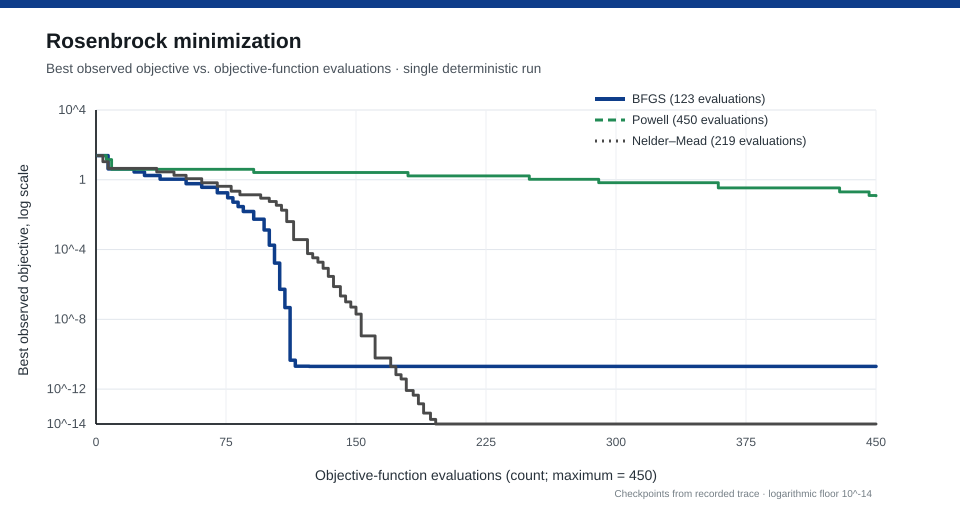
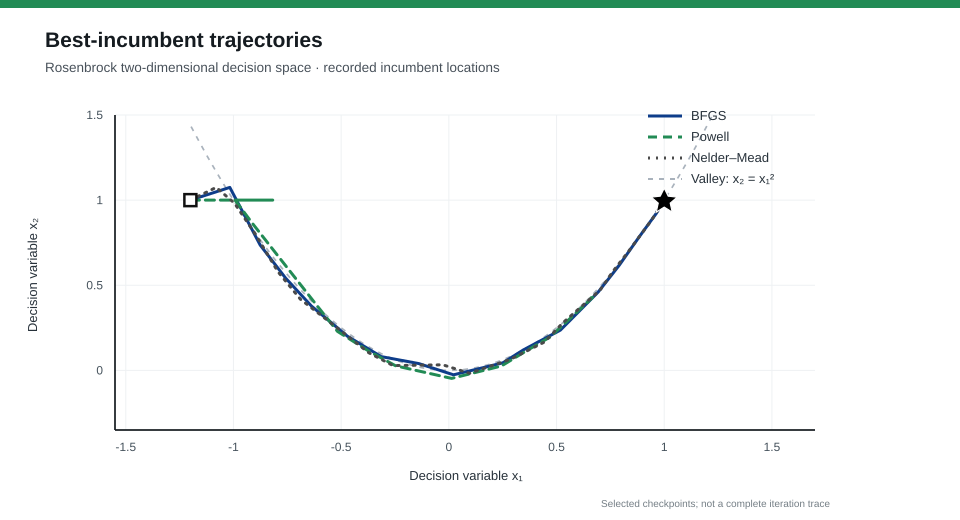

<div align="center">

# OPTIMIZATION ENGINEERING

**ROOTCASTLE ENGINEERING & INNOVATION**

*Reproducible numerical optimization · mathematical validation · safety-gated engineering deployment*

[Methodology](docs/methodology.md) · [Scientific validation](docs/validation_protocol.md) · [24-chapter index](docs/chapter_map.md) · [Skills](skills/README.md) · [84 research prompts](prompts/README.md)

</div>

---

## Abstract

**Optimization Engineering** is a modular, source-referenced engineering toolkit for transforming operational requirements into mathematically formulated, computationally tractable and independently verifiable optimization problems. It organizes **24 methodological chapters** from Kochenderfer and Wheeler (2026) into **one overarching and thirteen specialized agent workflows**, with **84 original English-language research prompts**, numerical sanity checks, and reproducible scientific visualizations.

The framework explicitly distinguishes *numerical convergence*, *mathematical optimality*, *constraint feasibility*, and *field-level operational safety*. A solver's termination message is treated as evidence about an algorithm run, **not** as a certificate that a physical machine, GNSS device, PCB design or control process is safe.

> **Scope:** engineering methodology and reference experiments. Not an independently peer-reviewed algorithm paper, not a validated industrial controller, and not a claim of compliance with any external safety standard.

## Associated research publication

[](https://doi.org/10.5281/zenodo.24046577)

**Batuhan Ayrıbaş (2026).** *Optimization Engineering: A Traceable Research-Software Workflow for Reproducible Numerical Optimization*. Zenodo, version 1. **DOI:** [10.5281/zenodo.24046577](https://doi.org/10.5281/zenodo.24046577).

The publication documents the rationale and evidence-gated research-software workflow underpinning this repository. Its reported experiments are single-problem numerical smoke tests, not statistical evidence of universal method superiority or a certified industrial-safety case. The Zenodo record specifies a **CC BY 4.0** license for the deposited work and categorizes the resource as a **Standard**; the repository does not claim peer-reviewed journal publication.

**Read the [publication and DOI](https://zenodo.org/records/24046577)** · **[View the deposited PDF](https://zenodo.org/records/24046577/files/Optimization_Engineering_Research_Paper_2026.pdf?download=1)** · **[BibTeX citation](CITATION.bib)** · **[Provenance and independent rights](docs/zenodo_publication.md)**.

For citation, distinguish the archived research publication (DOI above) from the separately versioned software repository. The concept DOI [10.5281/zenodo.24046576](https://doi.org/10.5281/zenodo.24046576) resolves to the latest version of the Zenodo publication.

## The problem formulation

For decision vector **x**, observed parameters **θ**, objective **f**, and feasible domain **X**, a basic constrained problem is:

```text
minimize     f(x; θ)
with x ∈ X
subject to   g_i(x; θ) ≤ 0   for each inequality constraint i
             h_j(x; θ) = 0   for each equality constraint j
```

If the parameters are uncertain, the uncertainty model and its epistemic limitations must be stated before robust or probabilistic guarantees are considered. Multiobjective and discrete problems require additional semantics; see [method selection](docs/method_selection.md).

## An independently reproduced optimization experiment

The Rosenbrock function is a standard nonlinear test problem with a curved valley:

```text
f(x₁, x₂) = (1 − x₁)² + 100(x₂ − x₁²)²
x₀ = (−1.2, 1.0); known global minimizer x* = (1, 1); f(x*) = 0.
```



*Figure 1. Best-observed objective values versus objective-function evaluations. This GitHub SVG renders measured, representative checkpoints; regenerate the complete evaluation trace with the accompanying Matplotlib script. Values below 10⁻¹⁴ are displayed at the plotting floor. Each solver has at most 450 objective evaluations; early terminations are extended visually as constant incumbents, not imputed measurements.*

| Method | Evaluations used | Best observed objective | Solver outcome |
|---|---:|---:|---|
| BFGS (numerical derivatives) | 123 | 2.00559 × 10⁻¹¹ | Converged |
| Powell | 450 | 1.20802 × 10⁻¹ | Evaluation limit reached |
| Nelder–Mead | 219 | 1.09909 × 10⁻¹⁸ | Converged |

**Interpretation:** these are observations from **one deterministic problem, one initial point and one computational environment** (NumPy 2.3.5, SciPy 1.17.0). They are *not* replicated trials, confidence intervals, or evidence of universal method superiority. Objective-evaluation parity does not imply equal processor cost, derivative information, or noise exposure. For full results and acceptance criteria, see [validation protocol](docs/validation_protocol.md).



*Figure 2. Selected best-incumbent locations. The gray curve is the Rosenbrock valley relation x₂ = x₁² (not an objective-level contour). The initial point and analytic minimizer are marked separately. The plotting source exports a denser contour version.*

## Core engineering design

```text
Evidence and units
      ↓
Mathematical formulation → model quality checks
      ↓
Solver selection → fixed-budget baseline comparison
      ↓
Optimizer adapter (replaceable; never a direct machine command)
      ↓
Independent constraint / safety validator
      ↓
Audit record: inputs, seed, tolerances, result, termination, residuals
      ↓
Read-only shadow deployment → operator authorization → monitored release
                                              ↘ rollback on gate failure
```

**Invariants:** never change a production core by default; never use an optimizer result to bypass a hardware interlock; never report global optimality without applicable proof or a valid certificate; preserve a reversible fallback.

## Contents

| Directory | Contents |
|---|---|
| [`skills/`](skills/README.md) | 14 installable-in-principle skill source directories, each with a `SKILL.md`, UI metadata and subject-matter reference notes |
| [`prompts/`](prompts/README.md) | 84 English technical prompts (24 chapters × 3 workflows, plus 12 Rootcastle application cases) in JSON, Markdown and CSV |
| [`docs/`](docs/methodology.md) | Technical foundations, algorithm selection, traceability, validation, complete chapter index and source rights |
| [`scripts/`](scripts/) | Benchmark driver, gradient checker and publication-style Matplotlib figure generator |
| [`tests/`](tests/) | Unit and numerical smoke tests |
| [`assets/figures/`](assets/figures/) | Vector scientific illustrations for this README; regeneration produces SVG, 350-DPI PNG and PDF |
| [`artifacts/`](artifacts/) | Recorded experimental summary; a full trace is regenerated rather than asserting permanent byte-for-byte reproducibility |

## Reproduce and verify

Requires **Python 3.10+**, NumPy, SciPy and Matplotlib. From the repository root:

```bash
python -m pip install -r requirements.txt
python -m unittest discover -s tests -v
python scripts/audit_gradient.py
python scripts/run_benchmarks.py --budget 450 --out-dir artifacts
python scripts/generate_figures.py --input artifacts/rosenbrock_traces.json --output assets/figures
```

All plots are based on explicit data sources. No invented error bars or statistical significance markers are used. Stochastic solver comparisons should additionally report seeds, uncertainty intervals, failure rates and equal-cost budgets.

## Source attribution and license boundary

The conceptual reference is **Mykel J. Kochenderfer and Tim A. Wheeler, *Algorithms for Optimization*, 2nd ed. (MIT Press, 2026)**. The supplied PDF indicates **Creative Commons Attribution–NonCommercial–NoDerivatives 4.0 International (CC BY-NC-ND 4.0)**. The source PDF, its illustrations, and extended excerpts are **not** redistributed here. All instructional prose, prompts, scripts and plotted experimental output are new materials. The repository's existing [MIT license](LICENSE) is retained; it does **not** override any third-party rights.

See [source, citations and license boundaries](docs/source_and_licensing.md). For publication citation metadata see [CITATION.cff](CITATION.cff).

**Maintained by [Rootcastle Engineering & Innovation](https://rootcastle.com).**

## Rootcastle project guide

[Project overview and practical workflow](https://rootcastle.com/en/projects/optimization-engineering/) · [Engineering walkthrough](https://rootcastle.com/en/engineering-notes/reproducible-numerical-optimization/)

The repository remains the reference for current setup, supported features and licensing. The project guide explains the workflow and its verification boundaries.
